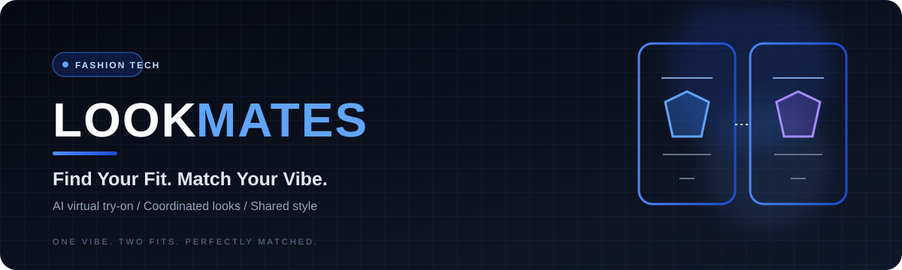
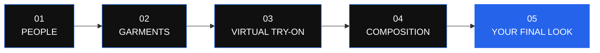

<div align="center">



<br />

# LOOKMATES®

### YOUR STYLE. THEIR STYLE. ONE PERFECT MATCH.

A new way to imagine fashion together.

**AI Virtual Try-On · Couple Styling · Shared Looks**

<br />

[](https://nextjs.org/)
[](https://www.typescriptlang.org/)
[](https://www.perfectcorp.com/business/showcase/ai-virtual-try-on)

<br />

**[Explore the repository](https://github.com/mohamed-kaif-1/LookMates)**

<br />

</div>

---

## THE FUTURE OF MATCHING LOOKS.

Choosing an outfit is personal. Finding two looks that belong together is an entirely different experience.

**LookMates** is a collaborative fashion-tech project built around one simple idea: make it easier for two people to visualize their styles, explore complementary outfits, and bring their looks together.

From individual virtual try-on to a shared final composition, LookMates reimagines fashion as something you can experience together.

<div align="center">

### TWO PEOPLE. DIFFERENT STYLES. ONE VISION.

*Not matching outfits. Matching energy.*

</div>

---

## 01 — THE EXPERIENCE

<table>
<tr>
<td width="50%" valign="top">

### 01. DUOMATCH

**Two looks. One connection.**

Create a coordinated styling experience for two people without forcing them into identical outfits.

- Separate participant profiles
- Individual garment selection
- Coordinated styling workflow
- A shared final presentation

</td>
<td width="50%" valign="top">

### 02. VIRTUAL TRY-ON

**See the possibility before the purchase.**

Connect individual looks to YouCam's virtual try-on technology and visualize how a selected garment appears on its intended person.

- Person-specific image inputs
- Garment-specific assignments
- Provider-backed image generation
- Clear processing and error states

</td>
</tr>
<tr>
<td width="50%" valign="top">

### 03. THE FINAL FRAME

**Two individual results. One composition.**

Bring the two try-on results together in a single visual presentation.

- Side-by-side image composition
- Consistent scaling and alignment
- Customizable presentation backgrounds
- Exportable output, where implemented

</td>
<td width="50%" valign="top">

### 04. STYLE DISCOVERY

**Find the balance between two styles.**

Explore a direction where colors, garments, and personal preferences can complement each other.

- Visual garment catalogue
- Outfit exploration
- Recommendation-led selection, where available
- Room to grow into group styling

</td>
</tr>
</table>

---

## 02 — THE JOURNEY

<div align="center">



</div>

**The principle:** each person's try-on is processed independently. Once the required results are available, the application can compose them into one shared image.

The composition stage is separate from the virtual try-on provider. A genuine provider result must never be replaced by a placeholder and presented as a successful generation.

---

## 03 — THE VISUAL IDENTITY

<div align="center">

| OBSIDIAN | PURE WHITE | ELECTRIC BLUE |
|:---:|:---:|:---:|
| `#0A0A0A` | `#FFFFFF` | `#3B82F6` |
| Precision | Clarity | Expression |

</div>

LookMates follows a restrained, fashion-first design philosophy.

- **Minimal by design.** Every section earns its place.
- **Bold where it matters.** Strong typography and confident contrast.
- **Image-led.** The people and garments remain the focus.
- **Responsive by default.** Designed for desktop and mobile experiences.
- **Purposeful motion.** Interactions should feel fluid, never distracting.

The goal is not to make the interface louder. It is to make the experience feel more considered.

---

## 04 — UNDER THE HOOD

| Layer | Role |
|---|---|
| Next.js | Web application framework |
| React | Component-driven interface |
| TypeScript | Typed application development |
| YouCam API | Virtual try-on integration, when configured |
| Image processing | Result composition and background processing, according to the implemented pipeline |

The architecture is intended to keep the interface, provider integration, and final image composition as distinct responsibilities.

### Engineering principles

**Correct image mapping**

Every try-on job must use the intended participant photograph and garment reference.

**Secure provider access**

API credentials belong on the server, never in browser-visible code or committed files.

**Honest processing states**

A result is complete only after the provider returns a valid output and the application verifies it.

**Graceful failure**

Invalid inputs, API errors, timeouts, and failed jobs should produce understandable messages and recovery paths.

---

## 05 — RUN IT LOCALLY

### Requirements

- Node.js compatible with the project's dependencies
- npm
- Git
- YouCam API credentials if the configured integration requires them

### Installation

**01 · Clone**

```bash
git clone https://github.com/mohamed-kaif-1/LookMates.git
cd LookMates
```

**02 · Install**

```bash
npm install
```

**03 · Configure**

Create `.env.local` if required by the application.

```dotenv
# Add the environment variables expected by your backend.
# Never commit actual API keys or secrets.
```

Use the exact environment-variable names expected by the code. Keep real credentials out of Git.

**04 · Launch**

```bash
npm run dev
```

Open [http://localhost:3000](http://localhost:3000).

**05 · Validate**

```bash
npm run lint
npm run build
```

Run these checks if the corresponding scripts are available in `package.json`.

---

## 06 — PRODUCT PREVIEW

<div align="center">

### DESIGNED TO BRING TWO LOOKS TOGETHER.

</div>

Add screenshots of the actual application here. A real before-and-after virtual try-on example will make this section much stronger.

```text
docs/
└── images/
    ├── lookmates-banner.svg
    ├── duomatch-workspace.png
    └── final-composition.png
```

Once those screenshots exist, replace this placeholder section with:

```markdown
<div align="center">

### THE DUOMATCH WORKSPACE


### THE FINAL COMPOSITION


</div>
```

Only use genuine screenshots and generated results from your project. Avoid presenting mockups as proof of working API integration.

---

## 07 — ROADMAP

The next stage is about making the complete experience reliable, not simply adding more screens.

- [ ] Verify real YouCam API requests and successful responses
- [ ] Complete and validate the DuoMatch journey
- [ ] Ensure participant and garment assignments remain correct
- [ ] Complete the two-result composition pipeline
- [ ] Verify transparent background processing
- [ ] Complete background customization and export
- [ ] Expand garment catalogue choices
- [ ] Finalize recommendation-to-try-on flow
- [ ] Test responsive layouts and accessibility
- [ ] Add automated tests for critical workflows
- [ ] Explore CrewMatch for larger groups

*Roadmap items are planned work until verified in the current implementation.*

---

## 08 — PRIVACY & RESPONSIBILITY

LookMates may process personal photographs and generated imagery. These assets should be treated with care.

- Keep API secrets server-side.
- Validate uploaded files and image sources.
- Avoid exposing private image URLs.
- Do not commit personal images, credentials, or sensitive databases.
- Define appropriate image-retention and deletion behavior.
- Follow the provider's API terms and applicable privacy requirements.

---

## 09 — BUILT FOR THE HACKATHON

<div align="center">

**YouCam API Skin AI & eCommerce VTO Hackathon**

LookMates explores how virtual try-on can become more than an individual product preview: it can become the beginning of a shared styling experience.

The vision is simple.

**Help two people see their looks separately—and imagine them together.**

</div>

---

## THE NEXT LOOK IS BETTER TOGETHER.

<div align="center">

**LOOKMATES®**

*Different styles. One perfect moment.*

<br />

[GitHub Repository](https://github.com/mohamed-kaif-1/LookMates)

<br />

<sub>Designed around people. Built around possibility.</sub>

</div>
