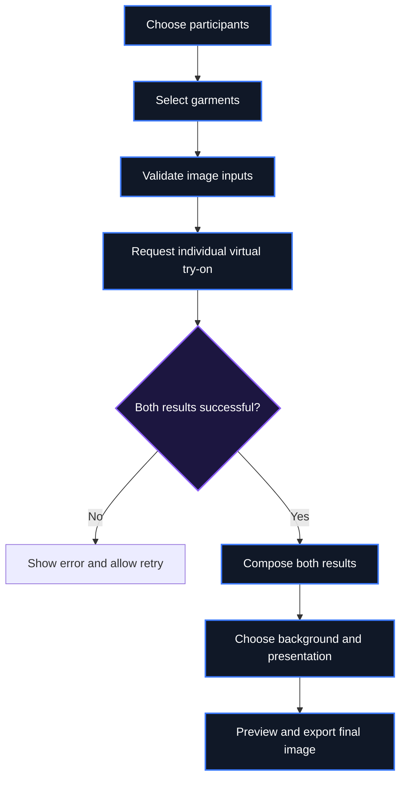

<div align="center">


# LOOKMATES

### Find Your Fit. Match Your Vibe.

**AI-powered virtual try-on. Coordinated looks. One shared style moment.**

[](https://nextjs.org/)
[](https://www.typescriptlang.org/)
[](#-the-experience)
[](#-hackathon)

**One vibe. Two fits. Perfectly matched.**

[Explore the experience](#-the-experience) · [Get started](#-get-started) · [Roadmap](#-roadmap)

</div>

---

## ✦ The idea

Online fashion shopping is personal. Coordinating outfits with someone else should be fun—not a guessing game.

**LookMates** explores a more social way to experience fashion: bring two people into one styling journey, visualize individual looks through virtual try-on, and bring the results together in a shared composition.

Instead of stopping at *“Does this outfit look good?”*, LookMates asks:

> **“How do our looks work together?”**

<table>
  <tr>
    <td width="33%" align="center">
      <h3>01 · TRY</h3>
      Visualize a selected garment on an individual.
    </td>
    <td width="33%" align="center">
      <h3>02 · MATCH</h3>
      Explore complementary styles for two people.
    </td>
    <td width="33%" align="center">
      <h3>03 · SHARE</h3>
      Bring the two results together in one composition.
    </td>
  </tr>
</table>

## ✨ The experience

<table>
  <tr>
    <td width="50%" valign="top">
      <h3>💙 DuoMatch</h3>
      <strong>Two people. One coordinated vision.</strong>
      <p>The core LookMates concept: select looks for two participants, generate their individual try-on results, and present the outcomes together.</p>
      <ul>
        <li>Separate participant and garment assignments</li>
        <li>Individual virtual try-on workflow</li>
        <li>Side-by-side final composition</li>
        <li>Background and presentation customization, where implemented</li>
      </ul>
    </td>
    <td width="50%" valign="top">
      <h3>🪄 Virtual Try-On</h3>
      <strong>See the look beyond the product photo.</strong>
      <p>Designed to connect the app to YouCam's supported virtual try-on API so garment visualization can become part of the styling journey.</p>
      <ul>
        <li>Provider-backed image processing</li>
        <li>Validated request and response handling</li>
        <li>Loading and failure states</li>
        <li>Server-side credential protection</li>
      </ul>
    </td>
  </tr>
  <tr>
    <td width="50%" valign="top">
      <h3>🎨 Final Look Studio</h3>
      <strong>Make the result feel complete.</strong>
      <p>A composition workflow for arranging both generated results in a single, balanced image.</p>
      <ul>
        <li>Proportional scaling and alignment</li>
        <li>Background-removal pipeline, when configured</li>
        <li>Selectable or custom backgrounds, where implemented</li>
        <li>Export-ready final composition</li>
      </ul>
    </td>
    <td width="50%" valign="top">
      <h3>👟 Style Discovery</h3>
      <strong>Complementary—not necessarily identical.</strong>
      <p>A styling direction built around helping two people find looks that work together across color, silhouette, and occasion.</p>
      <ul>
        <li>Garment catalogue exploration</li>
        <li>Coordinated outfit recommendations, where available</li>
        <li>Flexible individual styling</li>
        <li>Room for future group styling</li>
      </ul>
    </td>
  </tr>
</table>

> **Scope note:** LookMates is an evolving project. Descriptions such as “designed to,” “where implemented,” and “future” distinguish the product vision from functionality that still needs implementation or verification. Only mark a feature complete after testing it in the current codebase.

## 🖥️ Product preview

Add real screenshots or a short demo GIF here when available. Real product captures are more convincing to judges than generic stock images.

<div align="center">
  <table>
    <tr>
      <td align="center" width="50%">
        <strong>01 · DuoMatch workspace</strong><br/>
        <em>Add a screenshot of the participant and garment selection UI.</em>
      </td>
      <td align="center" width="50%">
        <strong>02 · Final composition</strong><br/>
        <em>Add a screenshot of two successful try-on results composed together.</em>
      </td>
    </tr>
  </table>
</div>

<!-- Replace the placeholders above with real screenshots, for example:


-->

## ⚡ How it works



The intended workflow keeps the two try-on jobs independent. Each result should remain associated with the correct participant and selected garment. The final composition should only run when the required outputs are available.

### Composition principles

- **Preserve proportions:** scale people without stretching the source images.
- **Align consistently:** use detected subject bounds where a segmentation pipeline is available.
- **Keep responsibilities separate:** virtual try-on, background segmentation, and image composition are different operations.
- **Handle partial failure:** if one try-on fails, show the failure and provide a retry path instead of presenting a misleading final result.

## 🎯 What makes LookMates different?

| Typical individual try-on | LookMates' direction |
|---|---|
| Focuses on one person's look | Designed around two participants |
| Reviews items one at a time | Explores coordinated outfit combinations |
| Presents separate product results | Aims to create one shared visual composition |
| Shopping is primarily individual | Styling becomes a collaborative experience |

LookMates is an exploration of **collaborative virtual fashion**, not a claim that every planned capability is already production-ready.

## 🎨 Design language

LookMates uses a bold fashion-tech visual direction:

- **Palette:** black, white, and electric blue
- **Style:** clean neo-brutalist accents with deliberate spacing
- **Structure:** strong headings, clear hierarchy, and grid-based layouts
- **Interaction:** responsive controls, useful feedback, and smooth transitions
- **Priority:** keep the outfit and the people at the center of the experience

## 🧰 Tech stack

| Layer | Technology |
|---|---|
| Web framework | Next.js |
| UI | React |
| Language | TypeScript |
| Code quality | ESLint |
| Virtual try-on | YouCam API integration, subject to configured endpoints and credentials |
| Image composition | Application image-processing pipeline, depending on installed implementation |

The repository includes a Next.js/TypeScript application. Confirm the exact dependencies and integrations against `package.json` and the current source before treating optional services as part of the live stack.

## 🚀 Get started

### Requirements

- Node.js version compatible with the project dependencies
- npm
- Git
- YouCam API credentials if required by the configured integration

### 1. Clone the repository

```bash
git clone https://github.com/mohamed-kaif-1/LookMates.git
cd LookMates
```

### 2. Install dependencies

```bash
npm install
```

### 3. Configure environment variables

Create `.env.local` only if the application expects environment variables.

```dotenv
# Example only — use the exact names expected by your backend.
# Add your provider key here locally; never commit real secrets.
```

Keep actual secrets out of source control. Do not copy example variable names blindly; use the names defined by the current application. Provider credentials must remain on the server and must never be exposed through browser code.

### 4. Start the development server

```bash
npm run dev
```

Open [http://localhost:3000](http://localhost:3000).

### 5. Run available checks

```bash
npm run lint
npm run build
```

These commands require the corresponding scripts to exist in `package.json`.

## 🔐 Security & privacy

Because the workflow may handle personal photos and provider credentials:

- Never commit `.env`, `.env.local`, API keys, or access tokens.
- Check `lookmates.db` before publishing; do not commit it if it contains private or sensitive data.
- Validate uploaded file types, file sizes, and remote image URLs.
- Keep provider requests and secret credentials on the server.
- Avoid exposing private image URLs in logs or public responses.
- Define appropriate retention and deletion behavior for uploaded and generated images.
- Follow the YouCam API terms and relevant privacy requirements.

## 🗺️ Roadmap

The roadmap below describes intended work. Update each item only after verifying it in the application.

- [ ] Verify end-to-end YouCam API integration with real successful responses
- [ ] Complete the two-participant DuoMatch workflow
- [ ] Validate participant-to-garment mapping and job tracking
- [ ] Complete the final image composition pipeline
- [ ] Validate background removal and transparent output
- [ ] Complete background selection and custom background upload
- [ ] Expand the garment catalogue and recommendation workflow
- [ ] Add resilient error handling, retries, and loading states
- [ ] Test mobile responsiveness and accessibility
- [ ] Add automated tests for the critical user journey
- [ ] Explore **CrewMatch** for larger groups

## 🧪 Validation checklist

Before calling the main workflow complete, verify:

- [ ] Both participant images pass input validation.
- [ ] Each garment is assigned to the intended participant.
- [ ] API credentials are not sent to the browser.
- [ ] Provider errors and missing output URLs are handled gracefully.
- [ ] The final composition only runs when the required results exist.
- [ ] People remain proportional and correctly aligned.
- [ ] Background selection and export work for supported formats.
- [ ] No private images, credentials, or database contents are exposed.
- [ ] The app builds and the available lint checks pass.

## 🏆 Hackathon

**Built for the YouCam API Skin AI & eCommerce VTO Hackathon.**

LookMates explores how virtual try-on can move beyond an isolated product preview and become part of a shared fashion decision. The project connects individual visualization, coordinated styling, and a combined presentation into one proposed experience.

For a strong submission, include:
- A live demo or recorded walkthrough
- Screenshots of the actual implemented interface
- A clear explanation of the YouCam API integration
- Example inputs and successful outputs that you have permission to share
- A transparent list of completed features and known limitations

## 🤝 Contributing

Ideas, bug reports, and improvements are welcome.

1. Fork the repository.
2. Create a feature branch: `git checkout -b feat/your-feature`
3. Make and test your changes.
4. Commit with a clear message.
5. Open a pull request describing the change.

## 📄 License

No license has been specified in this README. Add a `LICENSE` file before presenting the project as open source, and ensure the selected license matches your intentions.

---

<div align="center">

### LOOKMATES

**Better outfits. Better matches. Better moments.**

*Find your fit. Match your vibe.*

</div>
